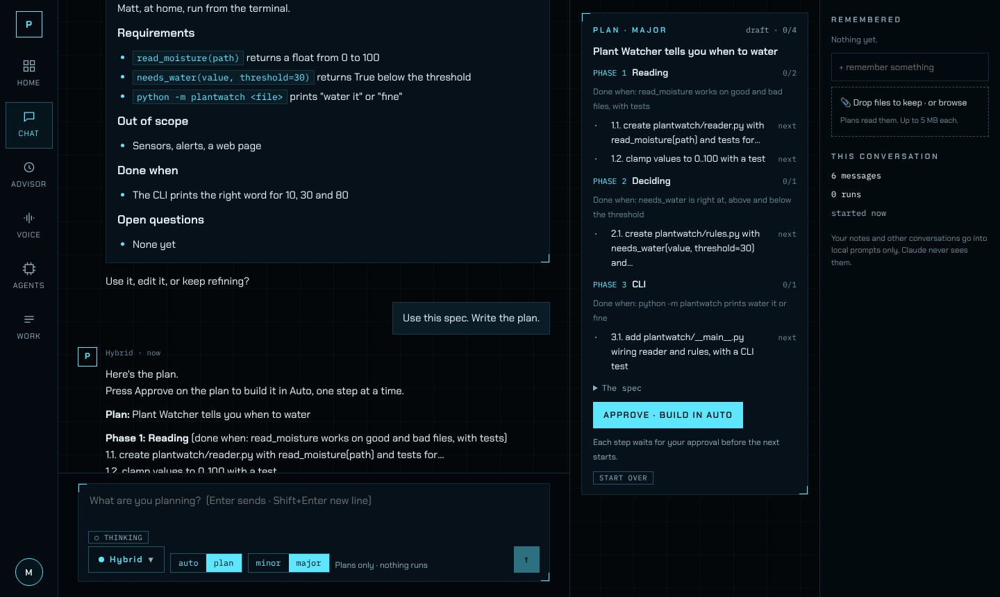
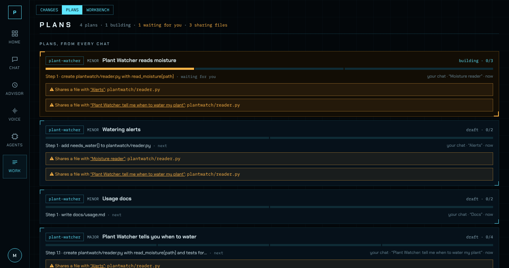

# Pablo

[](https://github.com/Mateo610/pablo-harness/actions/workflows/ci.yml)


[](LICENSE)

**A self-hosted AI coding harness that runs a team of local models on one GPU, verifies every
change in a sandbox, and leaves the merge decision to a human.**

You ask for a change in the browser, by voice, or in the terminal. Pablo routes it to the local
model best suited to it, makes the change in a scratch copy, runs the tests and type checks in a
sealed no-network container, and has a separate judge model score how sure it is. Nothing lands in
your repo until you approve it. Everything runs on one machine (RTX 3090, 24 GB) with no cloud
calls and no telemetry; Claude is available only as an escalation you choose on purpose.



## Engineering highlights

- **Every diff is verified, and blamed fairly.** Changes are applied to a scratch copy and checked
  in rootless Podman + gVisor with no network, a process cap, a pinned CPU set and a memory cap,
  failing closed. A failing check is re-run on the unedited copy, so a change is only blamed for
  what it made worse. ([verify.py](src/pablo/verify.py), [sandbox.py](src/pablo/sandbox.py))
- **Evaluation that can't be gamed.** A 36-task suite is scored by hidden tests the model never
  sees, run in a throwaway home so eval runs never become training data, plus a 12-task holdout,
  a build-from-empty set, a chat-behavior set, and judge fixtures replayed from real diffs. Ideas
  are kept only if they beat the 3-run noise floor, and several were dropped because they didn't.
  ([evals/](evals), [docs/review/evals.md](docs/review/evals.md))
- **Four models in 24 GB of VRAM.** A model swapper keeps a CPU router resident while the coder,
  judge and a 120B MoE take turns on the GPU (KV-cache quantization, MoE expert offload, every fit
  measured). A GPU lease scheduler orders the work: voice, then chat, then runs, then overnight
  jobs. ([gpu.py](src/pablo/gpu.py), [config/llama-swap.yaml](config/llama-swap.yaml),
  [docs/benchmarks.md](docs/benchmarks.md))
- **Calibrated judging.** The judge was chosen in a bake-off on real diffs labeled by hidden tests,
  by how often it wrongly calls a change ready, and its prompt is frozen and scored once on a
  holdout so it isn't tuned on its own test set. ([judge.py](src/pablo/judge.py),
  [docs/review/judge.md](docs/review/judge.md))
- **Invariants enforced by tests.** The router can never auto-escalate to Claude; Claude's
  outputs are never marked trainable; only `Orchestrator.approve` writes to the working tree;
  servers refuse to bind `0.0.0.0`. See [AGENTS.md](AGENTS.md).
- **Multi-user without passwords.** Teammates are identified by Tailscale (`tailscale whois` on
  the peer IP, never by headers), with owner and member roles, one-time invites, and
  DNS-rebinding protection on the API. ([access.py](src/pablo/access.py),
  [docs/teammates.md](docs/teammates.md))
- **Full stack.** Python core (FastAPI, Typer, Textual TUI), a React + Vite cockpit and phone PWA,
  streaming over SSE, and local voice (whisper.cpp in, Qwen3-TTS out, spoken as it streams).

## How a change gets made

```
you ── chat · voice · terminal ── Pablo ── router (Qwen3.5 4B) ─┬─ Base      Qwen3.6 35B-A3B
                                    │                           ├─ Best      gpt-oss-120b
                                    │                           └─ Advisor   Mistral Small 3.2 24B (unfiltered)
                                    ├─ checks: diff → no-network container → tests, types, imports
                                    └─ judge (Qwen3.8 27B): sure → ready · unsure → needs you
```

1. **Route.** A small CPU-resident router picks the lane. *Hybrid* lets it pick, judge, and retry
   on a bigger model; or you pick the model yourself.
2. **Write.** The model gets a token-budgeted prompt: files chosen by the symbols the task names,
   a repo map, and any skill card that fits. It answers in find-and-replace edit blocks that git
   turns into a diff.
3. **Check.** The diff is applied to a scratch copy and the checks run in the sandbox.
4. **Judge.** A separate model scores how sure it is that the change does what was asked.
5. **You decide.** Apply all of it or hunk by hunk (partial approvals are re-checked first).

## Results

Measured on the reference box (one RTX 3090), on this project's own eval sets, not public
benchmarks. [docs/review](docs/review/README.md) has the details and the weak spots, and
[docs/benchmarks.md](docs/benchmarks.md) every run.

| | Result |
|---|---|
| 36 coding tasks, scored by hidden tests: Base | **86%** ± 3 (3 runs) |
| Same tasks, Hybrid (router picks, judge, retry) | **89%** ± 7 (3 runs) |
| Same tasks, Best alone | **94%** (1 run, ~3.5 h) |
| Chat does the right thing (answer, change, or plan) on 22 messages | **20/22** typed, **22/22** spoken |
| Small tools built from an empty project in plan mode | **4/5** pass their acceptance test (latest of 3 runs: 1, 2, 4) |
| Base speed | ~120 tokens/s; voice's first word ~4.6 s median (target 2.5 s) |

What the measurements changed:

- The 120B "deep" model first *tied* the 35B coder. The cause was context, not the model: it was
  being shown the wrong files. After symbol-based file picking it scored 34/36.
- A repo map, two-step lookup, and fix-on-red each moved the mean by less than the run-to-run
  spread, so none was counted as a win.
- Task-derived spec checks cut false "ready" verdicts from 7 to 2 but raised false alarms, so they
  stay off until that's fixed.
- The shared blind spot: when a model writes a test that agrees with its own misreading of the
  task, every check passes and every judge misses it. That's the next thing to solve.

## Using it

- **Chat** in *Auto* (answers and makes changes) or *Plan* (nothing runs until you approve).
  *Plan · Major* interviews you, writes a spec, then a phased plan that Auto builds a step at a
  time, each step checked and waiting for you.
- **Voice**: talk to it in the browser; it can plan and build by voice.
- **Advisor**: a second builder on an unfiltered model, kept apart from the guardrailed lanes so
  mixing them doesn't cause refusals; its runs are marked self-judged and never trained on.
- **Work**: the review desk. Runs grouped by project and plan, every chat's plan with its
  progress, and warnings when two plans touch the same files.
- **Memory, projects, overnight queue**: notes are kept only when you keep them, per person;
  queued work runs 01:00–06:30 and you get a morning brief.



## Tech stack

| | |
|---|---|
| Core | Python 3.11+, FastAPI, Typer, Textual, Pydantic, tree-sitter · `mypy --strict`, ruff, pytest |
| Cockpit | React 18, TypeScript, Vite, cmdk · installable PWA for phone |
| Models | llama.cpp served through llama-swap, behind a LiteLLM gateway · GGUF weights archived with checksums |
| Isolation | rootless Podman + gVisor (`runsc`) |
| Voice | whisper.cpp (speech to text), Qwen3-TTS (speech) |
| Network | Tailscale for identity and transport; binds only to 127.0.0.1 or the tailnet IP |
| Learning | LoRA training on approved runs (Unsloth), promoted only if the eval suite improves |

## Try it

Tests and type checks run anywhere, with no GPU (models are replaced by a fake backend):

```bash
uv sync
uv run pytest -q
uv run ruff check src tests && uv run mypy
cd web && npm ci && npm run dev        # cockpit on :5173
```

Running the real thing needs a 24 GB GPU, 64 GB of RAM and Tailscale; see
[docs/running.md](docs/running.md).

## Repository map

| | |
|---|---|
| [`src/pablo/`](src/pablo) | the harness: routing, the run, checks, judge, chat and plans, voice, GPU scheduler, API, CLI |
| [`web/`](web) | the cockpit: Home, Chat, Advisor, Voice, Agents, Work, and the phone view |
| [`tests/`](tests) | 430+ tests, all GPU-free |
| [`evals/`](evals) | coding suite with hidden tests, holdout, chat and build sets, judge fixtures, results |
| [`config/`](config) | lanes and models, the gateway, the model swapper |
| [`scripts/`](scripts) | server bootstrap, systemd units, model archiving, teammate join scripts |
| [`docs/`](docs/README.md) | design decisions, benchmarks, per-area reviews, roadmap, operations |

## How it was built

Pablo is built by one developer working with AI coding agents: the GPU-free core with Claude, the
hardware side with Cursor on the server itself, one milestone spec at a time. Every change follows
[AGENTS.md](AGENTS.md), and every milestone has a gate that has to be measured before it closes.
The paper trail is in the repo: [100+ recorded decisions](docs/decisions.md),
[raw benchmarks](docs/benchmarks.md), an [honest review of each area](docs/review/README.md) with
every claim tagged *measured*, *observed* or *suspected*, and the [roadmap](docs/BUILD_PLAN.md).

## Status

In daily use by its owner, with teammates joining. Next: making Major plans trustworthy (plan
checks and repair), skills and `/loop`, voice latency, and the phone layout. See
[docs/BUILD_PLAN.md](docs/BUILD_PLAN.md).

## License

Apache-2.0. See [NOTICE](NOTICE) and [THIRD_PARTY.md](THIRD_PARTY.md).
