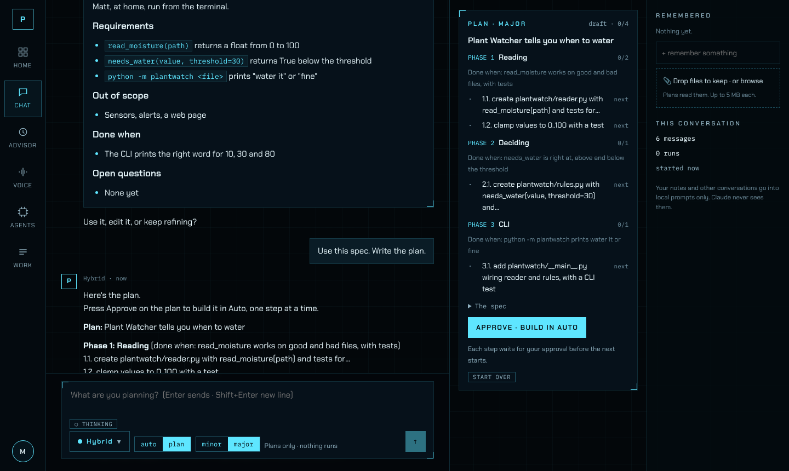
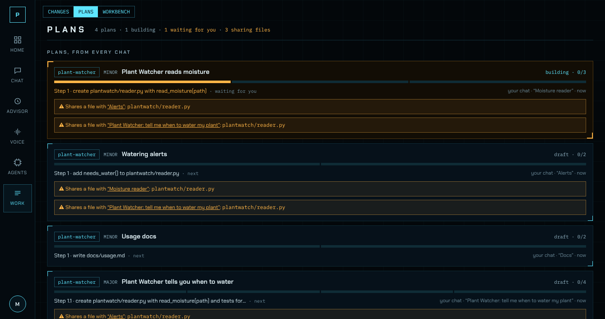

# Pablo

**A private AI coding team that runs on one box we own.**

You ask for a change in the browser, by voice, or in the terminal. Pablo routes it to the local
model best suited to it, makes the change in a scratch copy, runs the tests and type checks in a
sealed container, and has a judge model say how sure it is. Nothing lands in your repo until you
approve it. No cloud, no telemetry. Claude is an escalation you choose on purpose, never automatic.



## What it's like to use

- **Chat, in two modes.** *Auto* answers questions and makes changes, deciding on its own when
  something needs a run. *Plan* is for thinking first, and nothing runs until you approve. Plan ·
  Minor asks a question or two, then writes steps. Plan · Major interviews you one question at a
  time, writes a spec you approve, then a plan in phases. Approve it and Auto builds it a step at a
  time, each step checked and waiting for you.
- **Voice.** Talk to Pablo in the browser. Speech-to-text and speech run on Pablo (whisper.cpp,
  Qwen3-TTS), and replies are spoken while they stream. It can plan and build by voice, and tells
  you when a step is ready.
- **Advisor.** A second builder with no guardrails (a Mistral Small 3.2 24B "heretic"), for the
  perspective a guardrailed team won't give. It plans and builds in any project, and marks its
  runs self-judged.
- **Work.** One place to decide on changes: runs grouped by project and plan, every chat's plan
  with its progress, and a warning when two plans touch the same files. When a run gets stuck,
  its card can *Fix it* (try again, told what went wrong), *Retry*, *Skip step*, or send the
  details to chat.
- **Memory and projects.** Notes are kept only when you keep them, per person. Each project has
  its own conversations and plans, and runs share one GPU through a scheduler: voice first, then
  chat, then runs, then night work.
- **Overnight.** Queue work for 01:00–06:30 and read the morning brief.



## How a change gets made

```
you ── chat · voice · terminal ── Pablo ── router (Qwen3.5 4B) ─┬─ Base           Qwen3.6 35B-A3B
                                    │                           ├─ Best           gpt-oss-120b
                                    │                           └─ No guardrails  Mistral Small 3.2 24B
                                    ├─ checks: diff → no-network container → tests, types, imports
                                    └─ judge (Qwen3.8 27B): sure → ready · unsure → needs you
```

1. **Route.** A small router picks the lane. *Hybrid* lets it pick, judge, and retry on a bigger
   model; or you pick the model yourself.
2. **Write.** The model gets a budgeted prompt: the files your task names, the repo map, and any
   skill card that fits.
3. **Check.** The diff is applied to a scratch copy and the checks run in a rootless container
   (Podman + gVisor) with no network. A failing check is rerun without the diff, so the change is
   only blamed for what it made worse.
4. **Judge.** A separate model scores how sure it is that the change does what you asked.
5. **You decide.** Apply all of it, or hunk by hunk. Only the owner can apply.

## How it does

Measured on our own hardware (one RTX 3090), on our eval sets, not public benchmarks.
[docs/review](docs/review/README.md) has the details and the weak spots, and
[docs/benchmarks.md](docs/benchmarks.md) every run.

| | Result |
|---|---|
| 36 coding tasks, scored by hidden tests: Base | **86%** ± 3 (3 runs) |
| Same tasks, Hybrid (router picks, judge, retry) | **89%** ± 7 (3 runs) |
| Same tasks, Best alone | **94%** (1 run, ~3.5 h) |
| Chat does the right thing (answer, change, or plan) on 22 messages | **20/22** typed, **22/22** spoken (latest run of each, Nov 6–7) |
| Small tools built from an empty project in plan mode | **4/5** pass their acceptance test (latest of 3 runs: 1, 2, 4) |
| Base speed | ~120 tokens/s; voice's first word ~4.6 s median (target 2.5 s) |

Plan · Major, the Work board, and the stuck-run buttons are new (Nov 2026), and haven't been
measured on Pablo yet.

## Use it (teammates)

Matt sends you an invite. It has one command: paste it into Terminal (Mac, Linux) or
PowerShell (Windows). It installs Tailscale if you don't have it, has you accept access to
Pablo, then opens Pablo in your browser. Bookmark that page; that's it.

You get your own conversations and memory, and you see the team's runs. Only the owner applies
changes. Prefer the terminal? `uv tool install git+https://github.com/Mateo610/pablo-harness`,
then `pablo tui --url <the address you bookmarked>`. More in [docs/teammates.md](docs/teammates.md).

### Inviting someone (owner)

```bash
pablo invite --share-link <link> --note "Sam"   # first time; the share link is remembered
pablo invite --note "Alex"                      # after that
pablo invite --list                             # who used which invite
```

The share link is a reusable Tailscale share for this machine (admin console → Machines → pablo
→ Share → Copy invite link). Each `pablo invite` makes a one-time code that works for 7 days and
prints a message to send. Whoever opens it from the tailnet goes on `~/.pablo/access.yaml`.

## Everyday commands

| | |
|---|---|
| `pablo run "<task>"` | make a change: route, write, check, judge |
| `pablo approve / reject <run>` | your call; only approve touches the repo |
| `pablo chat` | talk in the terminal |
| `pablo tui` | the full cockpit in the terminal |
| `pablo queue add "<task>"` | overnight queue (runs 01:00–06:30) |
| `pablo brief` | what finished overnight and what needs you |
| `pablo doctor` | check the model gateway, GPU and disk |
| `pablo eval` · `eval-chat` · `eval-build` | rerun the numbers above |

`pablo --help` lists the rest.

## Running the server

Pablo is built for one Ubuntu box with a 24 GB GPU and 64 GB of RAM, on Tailscale.

```bash
bash scripts/bootstrap-pablo.sh --install   # checks GPU, CUDA, Tailscale; installs the basics
bash scripts/start-lanes.sh                 # model swapper + gateway as systemd user units
uv run pablo cert                           # HTTPS, so the browser allows the mic
uv run pablo serve --host $(tailscale ip -4)
```

Pablo only binds to 127.0.0.1 or the Tailscale IP, never every interface. To work on Pablo
itself: `uv sync`, `uv run pytest -q` (no GPU needed), `uv run ruff check src tests && uv run
mypy`, and `cd web && npm ci && npm run dev` for the cockpit.

## What's where

| | |
|---|---|
| `src/pablo/` | the harness: routing, the run, checks, judge, chat and plans, voice, GPU scheduler, API, CLI |
| `web/` | the cockpit (React + Vite): Home, Chat, Advisor, Voice, Agents, Work, and the phone view |
| `config/` | lanes and models (`lanes.yaml`), the gateway, the model swapper |
| `evals/` | the coding suite with hidden tests, the holdout, chat and build sets, judge fixtures |
| `docs/` | [BUILD_PLAN](docs/BUILD_PLAN.md) (roadmap and status), [decisions](docs/decisions.md), [review](docs/review/README.md), Cursor prompts for Pablo-side work |
| `scripts/` | Pablo bootstrap, lanes, systemd units, model archiving, the join script |

[AGENTS.md](AGENTS.md) has the rules every change follows, for people and for coding agents.

## Ground rules

- **Proof beside the claim.** Every change comes with its test results and the diff.
- **You're the merge button.** Models never write to your repo on their own.
- **Never auto-escalate.** The router can't choose Claude; only you can send a run there.
- **Owned outright.** Weights are archived with checksums, it runs offline, and Claude's outputs
  are never used for training.

## Status

Pablo is in daily use by its owner, with teammates joining. What's next (skills and `/loop`,
checks that make Major plans trustworthy, voice latency, the phone layout) and what's done is in
[docs/BUILD_PLAN.md](docs/BUILD_PLAN.md).

## License

Apache-2.0. See [NOTICE](NOTICE) and [THIRD_PARTY.md](THIRD_PARTY.md).
